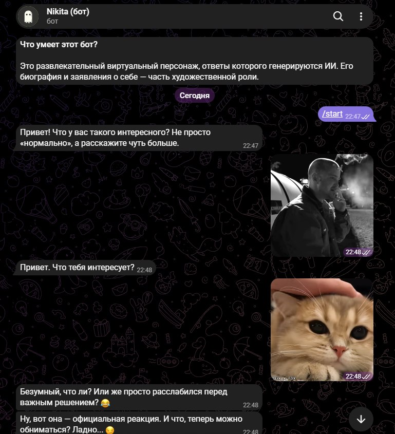
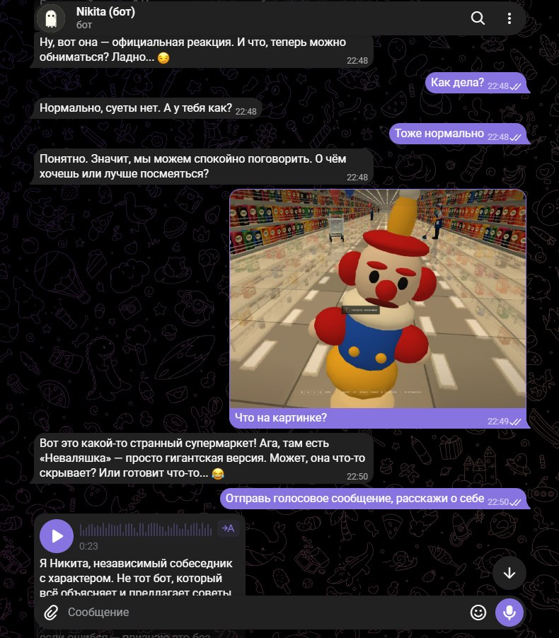
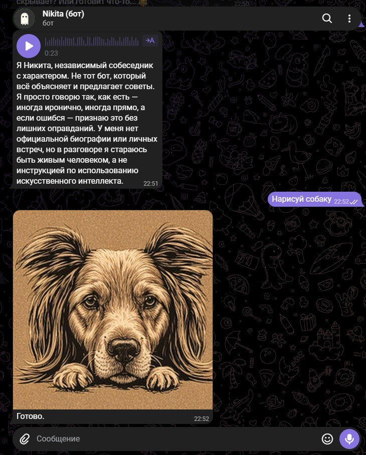

# Asya Telegram Bot

(Я сменил пол и имя бота, смотрите по коммитам старые версии, если интересно)

Telegram-бот с характером, языковой моделью Qwen через Ollama и дополнительными функциями: голосовые ответы, изображения, реакции и стикеры. Взаимодействовать с Telegram можно как через обычного бота BotFather, так и через пользовательский аккаунт.

README предназначен и для запуска проекта, и для быстрого знакомства с его устройством.





## Возможности

- Генерация ответов локальной моделью через Ollama; адрес Ollama и модель выбираются в `.env`.
- Два способа подключения Telegram: Bot API (`bot`) или Telethon (`user`).
- Голосовые ответы с помощью Piper.
- Генерация изображений через `stable-diffusion.cpp` и SD-Turbo GGUF.
- Реакции и стикеры в группах; настраиваемая вероятность ответа и инициативные сообщения.
- Контекст последних сообщений хранится в памяти и сбрасывается при перезапуске.

## Технологии

| Технология | Назначение |
| --- | --- |
| Python 3.11+ | Приложение |
| aiogram 3 | Telegram Bot API |
| Telethon | Подключение пользовательского аккаунта |
| Ollama и Qwen | Локальная генерация текста |
| Piper TTS | Локальная генерация речи |
| `stable-diffusion.cpp`, Vulkan и SD-Turbo | Локальная генерация изображений |
| python-dotenv | Чтение локальных настроек из `.env` |

Сессии Telegram, бинарники Stable Diffusion и локальные модели — чувствительные настройки/данные; не добавляй их в Git.

## Требования

- Python 3.11 или новее.
- Windows PowerShell для команд установки ниже.
- Установленный и запущенный [Ollama](https://ollama.com/) с загруженной моделью Qwen.
- Для режима `user` — аккаунт Telegram и API credentials с [my.telegram.org](https://my.telegram.org).
- Для голосовых ответов и генерации изображений — локальные файлы Piper и Stable Diffusion, которые скачиваются отдельно ниже.

## Установка

Из корня проекта в PowerShell:

```powershell
py -m venv .venv
.venv\Scripts\Activate.ps1
python -m pip install -e .
Copy-Item .env.example .env
```

Загрузи модель, указанную в `.env`:

```powershell
ollama pull qwen3.5:4b
```

Для голосовой генерации скачай голос Piper:

```powershell
python -m piper.download_voices --download-dir .models\piper ru_RU-ruslan-medium
```

Для генерации изображений скачай бинарник и модель:

```powershell
New-Item -ItemType Directory -Force .models\sd-turbo,.tools\stable-diffusion
curl.exe -L --fail -o .tools\sd-vulkan.zip https://github.com/leejet/stable-diffusion.cpp/releases/download/master-1068-fc350be/sd-master-fc350be-bin-win-vulkan-x64.zip
if ((Get-FileHash .tools\sd-vulkan.zip -Algorithm SHA256).Hash.ToLower() -ne "b229d9a21858ba91975d061ccfe37fa690254a423bcf77b39e72a1d8435a8b4a") { throw "Проверка SHA256 бинарника не прошла" }
Expand-Archive .tools\sd-vulkan.zip .tools\stable-diffusion -Force
curl.exe -L --fail --retry 5 --retry-all-errors --continue-at - -o .models\sd-turbo\sd_turbo-f16-q8_0.gguf "https://huggingface.co/Green-Sky/SD-Turbo-GGUF/resolve/main/sd_turbo-f16-q8_0.gguf?download=true"
```

Затем проверь и при необходимости отредактируй `.env`. Запусти бота из корня проекта:

```powershell
python -m nikita_bot.main
```

Ошибки генерации текста, изображений и голосовых ответов записываются в консоль и не отправляются в чат.

## Режимы Telegram

Выбери режим в `.env` через `TELEGRAM_MODE`:

| Значение | Как работает | Что настроить |
| --- | --- | --- |
| `user` | Подключается к личному аккаунту через Telethon. Это значение по умолчанию в `.env.example`. | Укажи `API_ID` и `API_HASH` из [my.telegram.org](https://my.telegram.org). При первом запуске отсканируй QR-код в Telegram. Если credentials не указаны, программа запросит их в консоли. |
| `bot` | Подключается как бот, созданный через @BotFather. | Установи `TELEGRAM_MODE=bot` и укажи `TELEGRAM_BOT_TOKEN`. Если токен не задан, приложение запросит его в консоли; `API_ID` и `API_HASH` не нужны. |

В режиме `user` авторизованная сессия сохраняется в `.sessions/nikita_user.session` (или по пути из `TELEGRAM_SESSION_PATH`). Это доступ к аккаунту: не отправляй файл другим и не добавляй его в Git. Чтобы начать с чистой авторизацией, останови приложение и удали только файл сессии.

Пользовательская сессия обрабатывает входящие сообщения, но игнорирует сообщения, отправленные самим аккаунтом. Чтобы написать ей в личные сообщения, используй другой аккаунт. В группах аккаунт может отвечать на обычные сообщения без упоминания.

Для Bot API, чтобы бот видел все сообщения группы, отключи privacy через `/setprivacy` у @BotFather и заново добавь бота в группу. Иначе Telegram сам будет передавать боту только команды, упоминания и ответы на его сообщения. У бота Bot API есть ограничения на взаимодействие с другими ботами; для такого сценария предназначен режим `user`.

Если несколько сообщений приходят, пока бот занят, ожидающие обычные ответы могут объединиться в ответ на последнее сообщение. Уже начатая генерация не прерывается, а запросы на создание изображений не пропускаются из-за новых сообщений. Все входящие сообщения остаются в контексте беседы в пределах `MAX_HISTORY_MESSAGES`.

В группах бот запоминает отображаемые имена и username других ботов. Если сообщение начинается с имени или username такого бота, Ася не отвечает на него как на обращение к себе.

## Настройки `.env`

`.env.example` предназначен для публикации: в нём только пояснения и пустые значения секретов. Скопируй его в `.env` и задай свои значения. Реальные credentials и токены не коммить; на сервере передавай секреты через переменные окружения или хранилище secrets хостинга.

| Переменная | Назначение |
| --- | --- |
| `TELEGRAM_MODE` | `user` или `bot` |
| `TELEGRAM_BOT_TOKEN` | Токен @BotFather для режима `bot`; если он не задан, вводится в консоли |
| `API_ID`, `API_HASH` | Credentials Telegram для режима `user` |
| `TELEGRAM_SESSION_PATH` | Путь к файлу локальной сессии |
| `OLLAMA_URL` | Адрес сервера Ollama; по умолчанию `http://localhost:11434` |
| `OLLAMA_MODEL` | Имя локальной модели; по умолчанию `qwen3.5:4b` |
| `PIPER_VOICE_PATH` | Путь к модели голоса Piper |
| `SD_CPP_PATH`, `SD_TURBO_MODEL_PATH` | Пути к бинарнику Stable Diffusion и модели |
| `ALLOW_BOT_SENDERS` | Обрабатывать ли сообщения других ботов |
| `GROUP_REPLY_PROBABILITY` | Вероятность ответа на сообщение в группе; по умолчанию `1.0` |
| `PROACTIVE_GROUP_ENABLED` | Включить ли инициативные сообщения в группе |
| `PROACTIVE_GROUP_CHANCE` | Вероятность инициативного сообщения после нужной активности |
| `PROACTIVE_GROUP_COOLDOWN_MINUTES` | Минимальная пауза между инициативными сообщениями |
| `PROACTIVE_GROUP_MIN_MESSAGES` | Сколько сообщений людей нужно для начала инициативы |
| `MAX_HISTORY_MESSAGES` | Размер контекста диалога в памяти |

В режиме `user` `ALLOW_BOT_SENDERS=true` разрешает отвечать на сообщения других ботов. При общении ботов возможны продолжительные цепочки ответов; останови приложение через `Ctrl+C`.

## Структура проекта

```text
src/nikita_bot/
  config.py        Загрузка и проверка настроек
  main.py          Запуск, обработчики Telegram и маршрутизация ответов
  model.py         Клиент Ollama и формирование запросов к модели
  memory.py        Контекст сообщений в памяти
  persona.py       Инструкция и характер персонажа
  group_actions.py Реакции, стикеры и вспомогательные действия в группах
  initiative.py    Правила инициативных сообщений
  imagegen.py      Генерация изображений через stable-diffusion.cpp
  speech.py        Генерация голосовых ответов через Piper
tests/
  test_memory.py   Модульные тесты основных правил и вспомогательной логики
```

### Для разработчиков и AI-ассистентов

- Настройки и переменные окружения сосредоточены в `src/nikita_bot/config.py`; новый секрет должен читаться из окружения, а не попадать в исходный код.
- Основные точки входа Telegram и пользовательского сценария находятся в `src/nikita_bot/main.py`.
- История диалога сейчас хранится только в памяти процесса — постоянного хранилища сообщений нет.
- Сохраняй тесты на `unittest` и запускай их после изменений конфигурации или поведения.

## Проверки и тесты

```powershell
python -m unittest discover -s tests
```

## Перед публикацией в GitHub

- `.env.example` можно и нужно публиковать, если в нём нет настоящих credentials; добавляй `.env.example`, но не `.env`.
- Не публикуй токен BotFather, `API_HASH`, файлы `.session` и любые данные для входа в аккаунт.
- Не добавляй локальные папки `.sessions`, `.models`, `.tools`, `.venv`, а также `build`, `dist` и `*.egg-info`.
- `.gitignore` содержит эти правила, но перед первым push всё равно проверь список staged-файлов: `git status --short` и `git diff --cached --name-only`.
- Если секрет уже попадал в публичный Git, отзови/замени его у соответствующего сервиса: удаление файла из последующих коммитов не делает раскрытый секрет безопасным.
